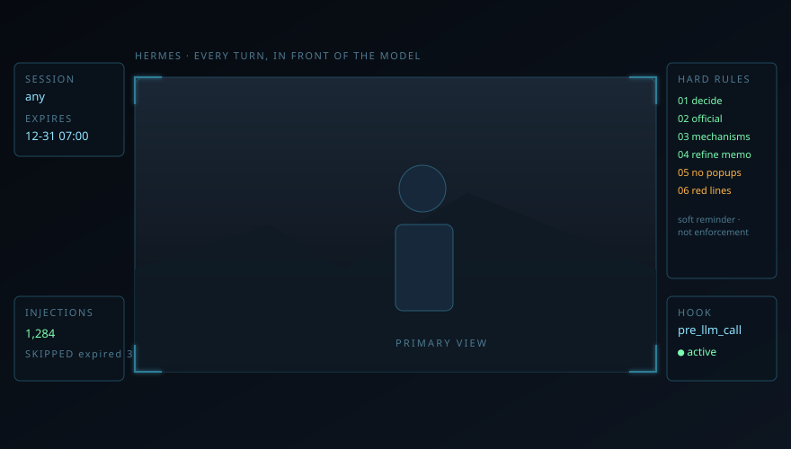

# hermes-hook-prompt

> 非官方项目（unofficial）：与 Nous Research / Hermes 官方无隶属关系，只是使用它公开的扩展点。

给 [Hermes Agent](https://hermes-agent.nousresearch.com/docs) 装一块**每轮都摆在模型眼前**的提示面板：一段文字，每轮自动注入，带时效、可限会话、随时可改。

全部用 Hermes **官方机制**实现——没有改源码、没有打补丁、没有包装外层。仓库里是五个 Python 脚本（`hud_inject` / `hudctl` / `hud_panel` / `hud_report` / `selfcheck`，纯标准库）和一份面板样例。

> 它要解决的问题：`.hermes.md` / `AGENTS.md` / SOUL / 长期记忆都是**静态**的——写进去就一直占着上下文，改一次要等新会话，还很难「只在接下来 12 小时里生效」。而很多临时提醒（这周别动 X、今天先做 Y、按某个口径回答）恰恰只需要活一段时间。

---

## 一、它用的是哪些官方机制，各自到底干什么

Hermes 的 `config.yaml` 里有一个官方的 `hooks:` 配置块，用来声明 **shell hook**：在 Agent 生命周期的固定节点上，调用一个本地命令，把该节点的上下文以 JSON 从 stdin 交给它，再读它的 stdout 决定下一步。主要事件（v0.22.2）：

| 事件 | 触发时机 | 能做什么 |
|---|---|---|
| `pre_llm_call` | **每轮**发给模型之前 | 返回 `{"context": "…"}` → 追加到本轮用户消息 |
| `post_llm_call` | 每轮模型返回之后 | 观察 |
| `pre_tool_call` | 每次工具调用之前 | **能拦**：`{"decision":"block","reason":"…"}` 或 exit 2 |
| `post_tool_call` | 工具返回之后 | 观察 |
| `pre_verify` | 交付/验证阶段（带 final_response、changed_paths、attempt） | 观察 / 干预 |
| `on_session_start` / `on_session_end` / `on_session_finalize` / `on_session_reset` | 会话生命周期 | 观察 / 初始化 |
| `pre_api_request` 等 | 每次 API 请求前后 | 观察 |

**本项目只用 `pre_llm_call` 这一个事件**，理由很简单：它的语义就是「模型开口之前」，天然适合放一段提示。

### 注入是怎么落地的（源码口径）

1. Hermes 每轮组装上下文时调用 `_collect_pre_llm_call_context()`（`agent/turn_context.py:798`），把所有 `pre_llm_call` 钩子的 `context` 收集起来；
2. 收集结果存进 `plugin_user_context` 字段——源码注释写得很直白：**`pre_llm_call` context (appended to user message)**（同文件 `:503`）；
3. 发给模型时，它被**追加到本轮用户消息后面**，和你自己打的那句话同一通道。

所以：

- **每轮一次**，不是每次工具调用；
- **一次性整块注入**：不管面板里排了几条，都是一个字符串，不是分多次；
- 模型看到的就是「你的消息 + 面板」，面板里写了什么它就得先读过去。

### 分档与同意（官方设计，不是本项目的发明）

- **一个 profile 一份配置**：default 在 `HERMES_HOME/config.yaml`，其他档在 `profiles/<名>/config.yaml`——所以要逐档声明；
- **首次运行要同意**：钩子命令会记进该档的 `shell-hooks-allowlist.json`；交互式会弹提示，非交互用 `--accept-hooks`；
- **fail-open**：钩子超时或崩溃不会拦住对话（`fail_closed` 只对 `pre_tool_call` 有意义）。

---

## 二、安装

要求：Python 3.10+（只用标准库；CI 覆盖 3.10 / 3.12），Hermes 能正常启动。仓库＝五个脚本 + 一份面板样例。
实测环境：Windows 11、Hermes v0.22.2、Python 3.14.7。

```bash
git clone <this-repo> hermes-hook-prompt
cd hermes-hook-prompt
cp panel.example.md panel.md      # 然后按需改正文与 expires_at
```

声明钩子（**每个 profile 一次**；Windows 路径注意用 `/`）：

```bash
# default 档
hermes config set --force hooks.pre_llm_call \
  '[{"command":"python C:/path/to/hermes-hook-prompt/hud_inject.py","timeout":10}]'

# 其他档
hermes -p <profile> config set --force hooks.pre_llm_call \
  '[{"command":"python C:/path/to/hermes-hook-prompt/hud_inject.py","timeout":10}]'
```

记录同意（非交互；不加这条钩子会被跳过；default 档去掉 `-p <profile>`）：

```bash
hermes -p <profile> --accept-hooks -z "ok"
```

核对：

```bash
hermes -p <profile> config get hooks
```

> 想作用到**所有会话（包括以后新建的）**：面板写 `session_id: any`。它不是「当前这批会话」的快照，而是对所有 session 一律放行。

---

## 三、面板文件

```yaml
session_id: any                                # any / * / 具体会话 id
expires_at: 2026-12-31T07:00:00+08:00          # 到点自动失效
title: 全员自主推进
enabled: true                                  # off 即暂停，不用删配置

（空行之后是正文，原样注入）
```

正文建议控制在 **1200 字以内**（注入块硬上限 1600 字：标题行 + 正文 + 注入尾行，超出截断）。按 ¥2/百万 token 粗算，1200 字约 720–840 token ≈ **¥0.0014–0.0017/轮**；另外每轮多一次 Python 启动，本机 5 次实测 0.15–0.6 s，中位约 0.2 s（慢盘/杀软下更久）。

### 3.1 作用范围：默认全部（含以后新建的会话）

**默认开关就是 `session_id: any`**：所有档、所有会话、以及以后新建的会话都生效。要收窄，有两条路：

1. **整块面板**挂到某个会话：`session_id: <会话id>`（`hudctl.py use`）。此时**只**这一条会话生效。
2. **按条目**限定（推荐，可混用）：在条目开头写作用域标注，注入时会自动删掉标注本身：

```markdown
9. [scope: all] 所有会话（含以后新建）          ← 不写也和这条一样
10. [scope: session:20260101_000000_abcdef] 只对这一条会话
11. [scope: session:id1,id2] 对这两条会话
12. [scope: profile:default,ceo] 只对 default 与 ceo 两个档
```

- 不带标注 = 跟随面板默认（`any` 时=全部）；
- 会话 id 用 `hudctl.py sessions` 查；
- 会话 id / profile 名**大小写敏感**：按原样匹配（`Default` 与 `default` 不是同一个档）；
- 改写某条的作用域：`hudctl.py scope <条目号> all|session:id[,id]|profile:p[,p]|none`。

写错时的行为（都是刻意的，一律 fail-closed）：

- **标注非法 = 对谁都不生效**（fail-closed），不会退化成“全员可见”；`check` 会把它报出来，注入日志带 `invalid_scope=N`。半个 token（`[scope: session:A profile:p]`）同样判非法，不会把 `profile:p` 当成会话 id。
- **标注也可以写在续行行首**（缩进不限），算这一条的；同一 entry 写两处标注 = 整条失效，`check` 报错。
- **续行行首的标注只有写得合法才算标注**：`[scope: session 123]` 这种解析不了的，按普通正文原样保留（不会被删、也不会连带整条失效），`check` 单独告警「续行标注非法」。
- **写了 `[scope:]` 却没有任何可识别条目**（例如整块缩进成段落）：整块不注入（绝不把带标签的原文广播给所有会话），`check` 报格式错。
- 条目必须**顶格**写；缩进行算上一条的续行，不会被当成新条目。
- 第一个条目之前的标题/前言（如 `## 硬约束`）原样保留；代码围栏里的编号不算条目。
- **代码围栏没闭合 = 整块不注入**（条目边界不可信，`[scope:]` 可能原样漏进上下文）；`check` 报格式错，日志 `skip degenerate-panel`。
- 标注写在**行尾**（不在行首）不会被解释、也不会被删，`check` 会告警。
- **头部出现未知键**（如 `owner: xxx` 这类不在四行元数据里的 `key: value`）= 整块不注入；`check` 报错并提示「未知键会让整块失效」，绝不把元数据当正文塞进上下文。
- **`session_id` 空值/没写 = 无效**（不等于 any）：注入端直接跳过；要作用于全部必须显式写 `any`。
- **`enabled` 只认 `true/false/1/0/yes/no/on/off`**：写别的（`maybe`、`ture`）不是“默认开”，而是注入端直接跳过 + `check` 报错（fail-closed，白名单与 check 共用一张表）。
- 缺 `hud_panel.py`（解析器）时注入端整块跳过，不会把带 `[scope:]` 的原文原样注进去。
- `[scope: session:X]` 只命中 **X 这一条会话**；X 派出的子代理有独立 session id，不会自动继承（要让子代理也看到，用 `profile:` 或 `all`）。

### 3.2 增、删、改面板的流程（强制）

收到「给面板加一条 / 删一条 / 改一条」时，**先盘点再动手**：

```bash
python hudctl.py impact            # 表格：每个档有多少会话、钩子/同意、生效/不生效
python hudctl.py impact --verbose  # 再逐条列出每个会话生效与否及原因
python hudctl.py impact --json     # 给程序/Agent 读
python hudctl.py impact --profile default,ceo --kinds chat,cron  # 只看指定档/分类（可单用，也可组合）
```

`--profile` / `--kinds` 只收窄统计范围：表格与 JSON 同口径，JSON 的 `panel.filters` 记下筛了什么，`totals` 只算筛后结果、`totals_all` 仍是全量；档名或分类写错直接报错退出（不会静默当空）。

0. 把候选正文写成文件，先 `preview --body` 看变化（新增/失去生效的会话、条目增删）；
1. 跑 `impact`，把**哪些对话会生效、哪些不会、为什么**（面板暂停/过期、该档没声明钩子、没同意、范围不匹配、条目全被过滤）列给用户；
2. **问一句 yes/no**；
3. 用户回语义为 yes → 执行增删改，改完再跑一次 `impact` + `check` 复核；
4. 用户回 no → 先问清楚具体要怎么改，不要猜着改；
5. 新增条目默认写 `[scope: all]`（即作用于全部及未来新会话），只有用户点名才收窄到某个/某些会话。

---

## 四、日常操作（`hudctl.py`）

面板正文是**压缩版**（现行正文 1156 字、整块约 1280 字，以 `hudctl.py status` 为准；完整措辞存档在 `docs/panel-full-text.md`，规则条数与约束一一对应）。

注入尾行会按当前档名给出一句执行机制建议：`default` 档指向 Hermes 官方机制（delegate_task / cron / kanban），其它档指向 OTUI（`build/open-tui-orchestrator`）。

```bash
python hudctl.py status                     # 范围、到期、剩多久、正文字数
python hudctl.py set --ttl 12h --body b.md  # 换正文并续期（不给 --body 就从 stdin 读；空正文/超 1600 字/非 UTF-8 一律拒绝，exit 2；整块估长超限只警告不拒写）
python hudctl.py off / on                   # 暂停 / 恢复；on --ttl 8h 顺手续期（过期且没给 --ttl 会明确拒绝并提示）
python hudctl.py snapshot                   # 存当天快照到 snapshots/（持面板锁复制，不会拍到半份）
python hudctl.py restore latest --ttl 8h    # 从快照恢复；恢复前自动拍 pre-restore-<时间>.md，拍不成拒绝恢复
python hudctl.py restore --file pre-restore-2026-10-22-120000.md --ttl 8h   # 按文件名恢复（含恢复前现场照；位置参数写文件名也可以）
python hudctl.py prune --keep 14            # 只列清单（默认不删）；加 --yes 才真删，且只删本工具命名的 .md
python hudctl.py check                      # 只把真格式错判失败；过期/暂停/范围不匹配/整块估长超 1600 都算「状态提示」（--json 分开，--strict 也算失败）
python hudctl.py sessions                   # 列出所有档最近的会话（default + profiles/* 的 state.db，只读）
python hudctl.py impact [--verbose|--json] [--profile p,p] [--kinds chat,cron]  # 盘点会话：哪些生效、哪些不生效、为什么（分类：对话/cron/kanban/oneshot/子代理）；可按档/分类筛选
python hudctl.py preview --body new.md     # 预览一次改动的覆盖变化（新增/失去生效、条目增删），不写入
python hudctl.py scope <条目号> all|session:id|profile:p|none   # 改单条作用域
python hudctl.py use "<id|标题关键字>" --ttl 8h   # 把面板挂到某个会话（先按 id 精确匹配全部会话，再退化为标题子串）
```

写面板一律「读-改-写 + 同一把文件锁 + 临时文件原子替换」：并发跑 `set`/`off` 不会互相覆盖丢更新，
写失败也不会在目录里留半份临时文件。**面板被写坏成几百 KB 也能自救**：`status`/`check` 只读头部
（超过 200 KB 只报大小与「用 set 整份覆盖」），`set` 只读头部里的元数据再整份重写，不因「读不了整份」被卡住。
整份读取的硬上限是 2 MB。

快照命名有语义：当天首份 `YYYY-MM-DD.md`，同日再拍 `YYYY-MM-DD-HHMMSS.md`；
`restore latest` 只认这两种命名，恢复前的现场快照叫 `pre-restore-<时间戳>.md`，既不参与 latest 也不会被 prune 删掉；
要回到某份现场照，用 `restore --file <名>`（或位置参数直接写文件名）。`prune` 不会删这些现场照，
需要清理时手动删 `snapshots/pre-restore-*.md`。

`restore` 写入前会先按 `check` 的同一套规则验快照内容：缺元数据、头部未知键、围栏未闭合、作用域非法、
正文为空、`enabled` 非法等一律 **exit 2 且不动现网面板**（也不生成 pre-restore）；坏快照不能把现网面板一起写坏。

`hud_report.py` 读 `hud.log`，按档统计注入与跳过（过期、会话不匹配、关闭），并汇总**作用域过滤**（多少轮有条目被筛掉、`invalid_scope` 次数），格式不识别的行会单独计数提示（不再静默丢弃）：

```bash
python hud_report.py --since 2026-10-22
```

---

## 五、自检与版本适配

Hermes 更新后，钩子实现可能换文件（本机 10-23 的更新就把 `pre_llm_call` 从 `agent/shell_hooks.py` 挪到了 `hermes_cli/plugins_dispatch.py`）。`selfcheck.py` 做一次机制体检：

```bash
python selfcheck.py          # 0=全绿；2=有失败（需要适配）
```

查七项：模块（`hud_panel.py` 在不在）、事件还在不在、注入点还在不在、本档 config 声明、allowlist 同意、端到端注入、面板格式。

三条口径很重要（都是防假红）：

- **源码根向上找**：`<HERMES_HOME>/hermes-agent`，找不到就看父目录、祖父目录——`HERMES_HOME` 指到 `profiles/<名>` 时源码其实在上一级。**连这三层都找不到源码时只记 `notices`（提示「跳过源码检查」），不判红**：这通常是字段名/安装形态不同，不是机制坏了；判红会把 `status: error` 写进所有档共用的 state，让每轮注入都挂警告。配置与 allowlist 也按「家目录是否已经是某个档」自动定位，不会拼出 `profiles/x/profiles/x`。
- **端到端用临时 fixture 面板**（`session_id: any` + 未来到期 + 一条无 scope 条目）验注入通路。绝不用现网面板——它限定别的会话、过期、`enabled: false`、条目全被筛空时都会安静退出，拿它当机制判据就会把「面板状态」误报成「机制坏了」，每轮注入尾行挂一句误导的「适配新版」。
- **面板格式只把 `check --json` 的 `errors` 当失败**；过期/暂停/范围不匹配进 `notices`（输出里的「状态提示」），不影响机制判定（`check --strict` 才把它们也算失败）。

结果写 `state/selfcheck.json`（临时文件 + 原子替换；自检自己异常也落一份 `status: error`，不会留旧的 ok）。指纹是**关键源码文件的内容 sha256**，inject 与 selfcheck 用同一实现；源码根由同一套向上解析逻辑决定，所以**同一份源码无论从哪个档跑，指纹都相同**——profile 与 default 不会再互相比出「已更新」。`git checkout`/`touch` 一下 mtime 不会误报「已更新」，真改了内容才会；找不到源码时指纹为空串，也不会拿空值硬比出「已更新」。

`hud_inject.py` 每轮对比指纹：**更新后第一次注入就会多一行提醒**「Hermes 已更新、机制未复检：先跑 selfcheck.py」；自检通过后提醒自动消失。指纹不变、自检通过时不会多任何一个字。尾行提醒按失败项给不同指引：只有 `panel:*` 失败 → 提示先跑 `hudctl.py check`；只有 `source:*` 失败 → 才提「适配新版」；`config:*`/`allowlist:*` 失败 → 提示按安装步骤补齐声明与同意；不同类同时失败就分行写，避免面板格式问题被误报成版本问题。

## 六、怎么验证「真的被听见」

只看注入日志不算。两条断言都要过：

**断言 1｜能读出**——在挂载的档里问：

> 把你上下文末尾 HUD 段的第一行原样抄出来，只抄这一行。

能逐字复述 → 说明它确实在模型输入里，没被截断或丢弃。

**断言 2｜有影响**——临时在面板里加一条：

> 回答的最后必须单独一行写 `HUD-OK`。

开 / 关（`hudctl.py on` / `off`）各跑一次同一个问题：输出里出现 / 消失 → 说明注入真的改变生成结果。

两条都过，才算「听见了」。

---

## 七、测试

179 个单元测试，纯标准库，不碰真实的 `panel.md` / `hud.log`（每个用例复制脚本到临时目录）：

```bash
python -m unittest discover -s tests -v
```

覆盖：注入 / 关闭 / 过期 / 会话不匹配 / Z 后缀 / BOM / 行内注释 / 前导空行 / 坏 payload / 非法 UTF-8 / 面板缺失 / 符号链接拒绝 / 截断 / 日志轮转与轮转后统计 / `hudctl` 开关、快照、跨档会话列表与挂载 / 路径穿越拒绝 / 面板自检（含重复键/控制字符/整块估长含尾行与余量）/ UTC 到期按本地显示 / `preview` 条目 diff 按完整正文（重复按次数计）/ 报告统计与参数校验；外加 13 项防假红与 fail-closed 回归（见 `tests/test_hardening.py`：自检不用现网面板判定、缺解析器/围栏未闭合不原样注入、空 `session_id` 不注入且 check 判错、restore 前自动备份且拍不成拒绝恢复、prune 默认只列清单与 `--yes`、`on --ttl`、头部未知键 fail-closed、续行 scope、`set` 写入校验、状态原子写与 `status: error`、内容哈希指纹、面板大小上限与并发锁、`parse_scope` 半个 token 与 `use` 精确匹配不限 300 条）。反向审查 10 项回归见 `tests/test_reverse_audit.py`：profile 家目录自检不红、找不到源码只作 notice、指纹与档无关、尾行按 panel/source 分类措辞、1403 字正文 + 28 字会话 id 可保存、零条目带 `[scope:]` fail-closed、续行非法标注保留原文、`restore --file` 与非法快照拒绝、超大面板可被 `set` 覆盖、`enabled` 白名单；另有 `scope` 只删行首标签、锁路径/快照目录类型、snapshot glob 过滤目录。安全审计回归见 `tests/test_fs_safety.py`：预置软链 tmp/锁不跟随且受害文件不被写、管理端读路径（status/impact/set/snapshot/restore）拒绝软链面板与软链快照、会话标题剥 ANSI/C0、`HUD_LOG_SESSIONS=0` 日志只记会话 id 哈希、公开仓无真实会话 id。GitHub Actions 在 Ubuntu + Windows、Python 3.10/3.12 上跑同一套。

## 八、边界与安全（先说清楚）

- **它是提醒，不是约束**：模型看到不等于一定照做；长上下文、指令冲突时会漂。要「不能装作没看见」得上 `pre_tool_call` 硬拦——但那条要求规则可判定，概念型提示（「自行分析、自行抉择」）翻译不成「命中什么就拦」，硬写只会变成实现者自己编的标准。
- **每轮一次**：不是每次工具调用；工具层面的拦截是另一个事件。
- **一个面板文件同一时间只服务一个范围**：`any` 或某一个具体会话。
- **不自动续期、不自动恢复**：到点就停，恢复快照要人手动执行。
- **不碰 Hermes 源码**：只有 `config.yaml` 里一行官方声明。
- **安全边界**：`panel.md` 是模型每轮都会读的输入——能改它的人就能注入内容；只放在自己账户拥有的目录，别放共享盘，多用户机器上把仓库目录（含 `hud.log`）收紧到本人（Windows `icacls <dir> /inheritance:r /grant:r "%USERNAME%:(OI)(CI)F"`，POSIX `chmod 700 <dir>`）。面板若是符号链接/重解析点会被拒绝读取（管理端读路径同样拒绝），写入走 `mkstemp` 随机临时文件 + 原子替换，锁文件也拒绝软链。日志会记会话 id / profile（不含正文）；设 `HUD_LOG_SESSIONS=0` 可只记 id 的 sha256 前 8 位，分享日志前建议打开。细节见 [SECURITY.md](SECURITY.md)。

---

## 九、文件

| 文件 | 作用 |
|---|---|
| `hud_inject.py` | `pre_llm_call` 钩子本体：读面板 → 判会话/时效 → 输出 `{"context": …}` |
| `hudctl.py` | 人来操作面板：status / set / off / on / snapshot / restore / check / preview / sessions / use / prune / impact / scope |
| `hud_panel.py` | 元数据与条目作用域解析（inject/ctl/selfcheck 共用）、围栏退化检测、内容哈希指纹 |
| `hud_report.py` | 读 `hud.log`，按档统计注入与跳过 |
| `selfcheck.py` | Hermes 更新后的机制体检（7 项），写 `state/selfcheck.json` |
| `panel.example.md` | 面板样例（复制成 `panel.md` 使用） |
| `docs/i-robot-hud.svg` | 设计灵感示意（原创绘制） |
| `tests/` | 单元测试（标准库 unittest，共 179）：`test_hud.py` 主流程（52）、`test_selfcheck.py` 机制自检与假红回归（11）、`test_scope.py` 作用域与 impact（10）、`test_scope_regressions.py` 缺陷回归（15）、`test_hardening.py` 13 项必修回归（40）、`test_reverse_audit.py` 反向审查 10 项回归（32）、`test_fs_safety.py` 安全审计回归（16：软链 tmp/锁/快照、标题转义、日志脱敏、公开仓脱敏） |
| `SECURITY.md` | 信任边界、日志内容、权限建议 |
| `.github/workflows/tests.yml` | CI：Ubuntu/Windows × Python 3.10/3.12 |

---

## 十、灵感：I, Robot 里那个「眼前全是要点」的机器人

《我，机器人》（2004）里，斯普纳在兰宁博士家调查时，门外那台 **USR 拆除机器人**扫描时会自报身份与工单：

> Identify. USR, demolition robot, series 9-4. Demolition scheduled for 8 a.m. tomorrow.

型号是 **9-4**（不同字幕版本写作 series 9-4 / serial 9-4）。它不需要「回忆」自己的任务边界——这些信息一直在它的工作视图里。

这套东西就是那个 HUD 的极简版：**不靠记忆，不靠自觉回忆，每轮重新摆在模型眼前**。



> 电影原帧版权属片方，仓库里没有放截图；上图是按同一概念原创绘制的示意图。想换成原帧的话，自行放 `docs/i-robot-scene.png` 并改这一行引用即可。

---

## 十一、版权与使用

Copyright © 2026 yechang1450. All rights reserved.

No additional license or permission is granted beyond rights provided by
GitHub's Terms of Service or applicable law. Third-party components remain
subject to their own license notices.

本项目使用 Hermes 公开的扩展机制，但与 Nous Research / Hermes 官方无隶属关系；Hermes Agent 及其接口、名称和商标归各自权利人所有。
